# Insights de Negócio

Respostas às 8 perguntas de negócio do projeto, calculadas em SQL sobre a base de dados limpa. Cada seção traz o resultado da consulta, o link para o arquivo `.sql` que o gerou e a leitura dos números.

**Base analisada:** 9.974 vendas de 2023, com faturamento total de 89.042,00 e ticket médio de $8.93.

## Faturamento e sazonalidade

### 1. Qual foi o desempenho geral de 2023?

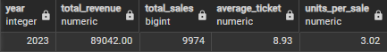

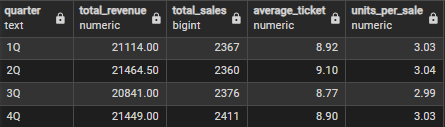

Consulta: [01_overall_performance.sql](../sql/01_performance_2023/overall_performance.sql)

**O que os dados mostram**

- Trimestre que mais faturou: 2Q, com $21,464.50.
- Trimestre que menos faturou: 3Q, com $20,841.00.
- Os trimestres somam um faturamento total de $84,868.50. Os $4,173.50 restantes são as vendas sem data, que entram só no total do ano.

### 2. Como o faturamento varia mês a mês e o que explica os melhores e piores meses?

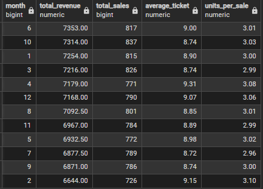

Consulta: [02_monthly_revenue.sql](../sql/02_monthly_revenue/02_monthly_revenue.sql)

**O que os dados mostram**

- Melhores meses em faturamento: junho em 1º lugar, com $7,353.00; outubro em 2º lugar, com $7,314.00 e janeiro em 3º lugar, com $7,254.00.
- Piores meses em faturamento: fevereiro em 12º lugar, com $6,644.00; setembro em 11º lugar, com $6,871.00 e julho em 10º lugar, com $6,877.50.
- O que explica a diferença é o número de vendas. O ticket médio varia pouco, de $8.72 a $9.31; e as unidades por venda ficam entre 2,96 e 3,10. Fevereiro, o pior mês, tem o segundo maior ticket do ano, com $9.15, mas só 726 vendas.
- Parte da queda de fevereiro é calendário. Ele tem 28 dias. Dividindo o faturamento pelos dias do mês, fevereiro dá cerca de $237.30 por dia, acima da média do ano ($84.868.50 ÷ 365 = $232.50). Pelo faturamento por dia, os meses mais fracos são julho, com $221.90 e maio, com $223.60.

### 3. Como as vendas se distribuem pela semana, e isso muda entre In-store e Takeaway?

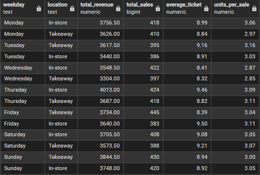

Consulta: [03_weekly_sales.sql](../sql/03_weekly_sales/03_weekly_sales.sql)

**O que os dados mostram**

- Melhor dia com os dois canais: a quinta tem o maior faturamento, com $7,700.00.
- Pior dia com os dois canais: a quarta tem o menor faturamento, com $6,852.50. Considerando todas as vendas com data, inclusive as sem canal, a diferença entre o melhor e o pior dia é de cerca de 6%.
- Os melhores dias mudam de canal: na loja (In-store) é a quinta, com $4,013.00; e para viagem (Takeaway) é o domingo, com $3.844.50. Os piores são a terça na loja, com $3,440.00; e a quarta para viagem, com $3,304.00.
- O faturamento baixo da quarta vem do ticket, e não do número de vendas: o ticket da quarta é o menor de cada canal, $8.41 na loja e $8.32 para viagem, mesmo com 422 e 397 vendas.

## Produtos e preço

### 4. Quais itens mais faturam, e quanto os 3 primeiros representam do total?

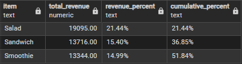

Consulta: [04_top3_items.sql](../sql/04_top3_items/04_top3_items.sql)

**O que os dados mostram**

- Melhores itens em faturamento: Salad em 1º lugar, com $19,095.00; Sandwich em 2º lugar, com $13,716.00 e Smoothie em 3º lugar, com $13,344.00. Juntos, os três produtos somam um faturamento de $46,155.00.
- Salad, Sandwich e Smoothie somam 51.84% do faturamento total, com 21.44%, 15.40% e 14.99% cada.
- Esses três itens correspondem a mais da metade do faturamento da cafeteria, mostrando uma alta concetração em poucos produtos.

### 5. O faturamento de cada item vem de volume ou de preço?

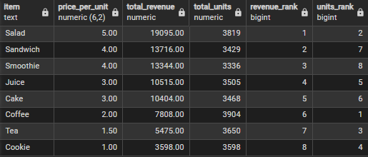

Consulta: [`05_reason_revenue.sql`](../sql/05_reason_revenue/05_reason_revenue.sql)

**O que os dados mostram**

- Item que mais fatura: Salad, com faturamento de $19,095.00; 3.819 unidades vendidas, o que o coloca em 2º lugar em unidades.
- Item que vende em unidades: Coffee, com 3.904 unidades vendidas; mas é apenas o 6º em faturamento, com $7,808.00.
- Sandwich e Smoothie, 2º e 3º em faturamento, são o 7º e o 8º em unidades.
- O preço influencia diteramenta no faturamento do item, mais que o volume de unidades. Sandwich e Smoothie mostram isso.

### 6. Quantas unidades o cliente leva por venda, e o ticket cresce com a quantidade?

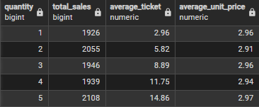

Consulta: [`06_units_per_sale.sql`](../sql/06_units_per_sale/06_units_per_sale.sql)

**O que os dados mostram**

- O cliente leva de 1 a 5 unidades, e cada quantidade representa cerca de 20% das vendas (de 1.926 a 2.108). Não há uma quantidade típica.
- O ticket cresce com a quantidade, de $2.96 para $14.86. Mas é um efeito direto: total é quantidade vezes preço.

## Canais e pagamento

### 7. In-store e Takeaway são negócios diferentes?

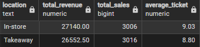

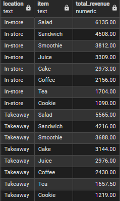

Consulta: [`07_revenue_location.sql`](../sql/07_revenue_location/07_revenue_location.sql)

**O que os dados mostram**

- O faturamento na loja, com $27,140.00, é 2.2% maior que o para viagem, que tem $26,552.50. Já o número de vendas é quase igual, 3.006 e 3.016.
- Os três itens que mais faturam são os mesmos, na mesma ordem: Salad, Sandwich e Smoothie. A diferença está na 4ª e 5ª posições: Juice vem antes de Cake na loja, com $3,309.00 e $2,973.00; e ao contrário para viagem, com $3,144.00 contra $2,976.00.
- A comparação usa as 6.022 vendas com canal informado, cerca de 60.4% da base.

### 8. Como os clientes pagam, e a forma de pagamento está ligada ao valor da compra?

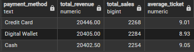

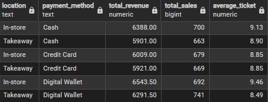

Consulta: [`08_customer_payment_method.sql`](../sql/08_customer_payment_method/08_customer_payment_method.sql)

**O que os dados mostram**

- As três formas têm faturamento e número de vendas quase idênticos. A diferença entre a maior e a menor é de $43.50 no faturamento e de 30 no número de vendas.
- Não dá para dizer qual forma é a mais usada. A diferença entre elas é muito menor que as 3.168 vendas sem forma de pagamento informada.
- O ticket médio fica entre $8.93 e $9.05, então a forma de pagamento não está ligada ao valor da compra.
- Por canal, o ticket de Digital Wallet é $9.46 na loja e $8.49 para viagem. O de Cash é $9.13 e $8.90. Credit Card fica igual nos dois, com $8.85.
